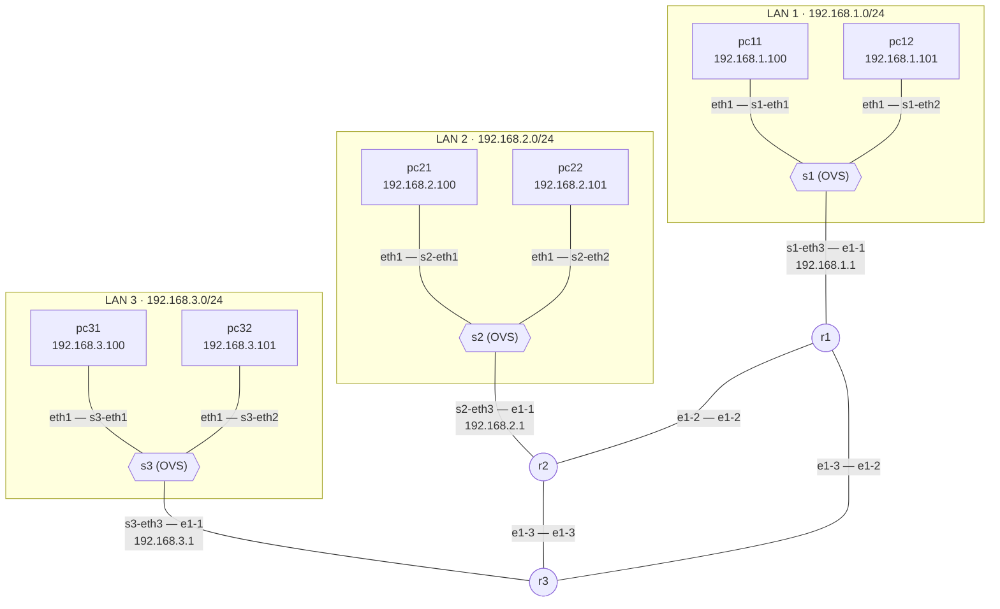

# Topología del escenario `routing-testbed` (module-2)

El escenario se define en [`routing-testbed.yaml`](routing-testbed.yaml) y se despliega con [`deploy-routing-testbed.sh`](deploy-routing-testbed.sh). Consta de tres routers Nokia SR Linux (`r1`, `r2`, `r3`) interconectados en triángulo y de tres LANs, una por router. Cada LAN es un *bridge* Open vSwitch (`s1`, `s2`, `s3`) con dos *hosts* Linux.

## Diagrama

>**Nota:** En la plantilla de Containerlab las interfaces de los routers se nombran `e1-N`, que corresponden a las interfaces `ethernet-1/N` de Nokia SR Linux.

## Nodos

| **Nodo** | **Tipo** | **Imagen / tipo** | **Contenedor** |
|----------|----------|-------------------|----------------|
| `r1`, `r2`, `r3` | Router Nokia SR Linux (`ixr-d2l`) | `ghcr.io/nokia/srlinux:latest` | `clab-routing-testbed-r1` ... `-r3` |
| `s1`, `s2`, `s3` | *Bridge* Open vSwitch | Creado en el *host* con `ovs-vsctl add-br` | (no es un contenedor) |
| `pc11` ... `pc32` | *Host* Linux | `wbitt/network-multitool:latest` | `clab-routing-testbed-pc11` ... `-pc32` |

Los routers y los *hosts* también se conectan, mediante su interfaz de gestión, a la red Docker de gestión de Containerlab (`clab`). Las operaciones gNMI se realizan a través de esta red, contra el puerto 57400 de cada router.

## Enlaces

| **Extremo A** | **Extremo B** | **Segmento** |
|---------------|---------------|--------------|
| `pc11:eth1` | `s1:s1-eth1` | LAN 1 |
| `pc12:eth1` | `s1:s1-eth2` | LAN 1 |
| `s1:s1-eth3` | `r1:ethernet-1/1` | LAN 1 |
| `pc21:eth1` | `s2:s2-eth1` | LAN 2 |
| `pc22:eth1` | `s2:s2-eth2` | LAN 2 |
| `s2:s2-eth3` | `r2:ethernet-1/1` | LAN 2 |
| `pc31:eth1` | `s3:s3-eth1` | LAN 3 |
| `pc32:eth1` | `s3:s3-eth2` | LAN 3 |
| `s3:s3-eth3` | `r3:ethernet-1/1` | LAN 3 |
| `r1:ethernet-1/2` | `r2:ethernet-1/2` | r1 <-> r2 |
| `r1:ethernet-1/3` | `r3:ethernet-1/2` | r1 <-> r3 |
| `r2:ethernet-1/3` | `r3:ethernet-1/3` | r2 <-> r3 |

## Configuración inicial

Tras el despliegue, el escenario solo tiene configuradas las LANs:

- **Routers:** la configuración de arranque ([`r1.cfg`](r1.cfg), [`r2.cfg`](r2.cfg), [`r3.cfg`](r3.cfg)) asigna la dirección `192.168.N.1/24` a `ethernet-1/1.0` y asocia esa subinterfaz a la *network-instance* `default`.
- **Hosts:** el *script* de despliegue asigna a `eth1` la dirección `192.168.N.100/24` o `192.168.N.101/24`, y añade rutas hacia las otras dos LANs con el router de su LAN (`192.168.N.1`) como siguiente salto.

Los enlaces entre routers (`ethernet-1/2` y `ethernet-1/3`) no tienen direccionamiento IP y no hay rutas estáticas configuradas. Por tanto, al desplegar el escenario no hay conectividad entre LANs distintas. Esa configuración se completa con gNMI usando las plantillas [`configure_ip_address.yaml`](configure_ip_address.yaml) y [`configure_ip_routing.yaml`](configure_ip_routing.yaml), según el plan de direccionamiento indicado en el enunciado.
